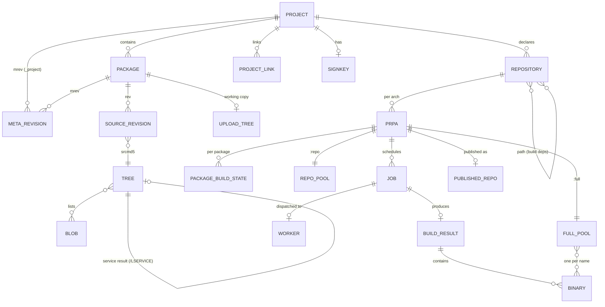

# 02 — Domain Model

Depends on: `00`. Source of truth for behaviour: `01-legacy-system-analysis.md`
(sections S = source server, B = scheduler/build path, P = publishing).

This document defines the entities, identifiers, and invariants that every
service shares. It is normative: the PostgreSQL schema in `04-storage.md`, the
protobuf messages in `proto/`, and the XML emitted by `compat-edge` all derive
from it.

## 1. Identifiers and naming rules

| Identifier | Rule (from `BSVerify.pm`, must be enforced identically) |
|---|---|
| project name | `[^/\0-\37]+`, no component (split on `:`) starting with `_` or `.`, ≤ 200 bytes. Hierarchical by `:` (e.g. `home:alice:branches:openSUSE:Factory`). |
| package name | as project name, plus no `:` except the multibuild form `<pkg>:<flavor>` and the generated forms `_product:<x>`, `_patchinfo:<x>`. Reserved names: `_project`, `_pattern`, `_product`, `_patchinfo`, `_repository`. |
| repository name | `[^/\0-\37:]+`, not starting with `_` or `.`. |
| architecture | member of the known architecture table (`BSCando.pm`, § 7). |
| file name | no `/`, no control characters, not starting with `.`, not `..`. |
| revision id | positive integer, 32-hex (srcmd5), 40-hex (git sha), or the words `upload`, `build`, `latest`, `repository`. `linkrev` may also be `base`. |
| `prp` | `<project>/<repository>`. |
| `prpa` | `<project>/<repository>/<arch>`. |
| job name | `<project>::<repository>::<package>-<srcmd5>` (plus `::<arch>` suffix in some views). Must remain stable because the Rails side and workers display it. |

Names are case-sensitive byte strings. Sort order anywhere a sort is
observable (directory listings, `srcmd5` computation, `:full` selection) is
byte order (`sort` in Perl with no locale).

## 2. Entities



### 2.1 Project

Fields (from `BSXML::proj`): `name`, `title`, `description`, `url`,
`kind` (`standard` | `maintenance` | `maintenance_incident` |
`maintenance_release`), `link[]` (project links with `vrevmode`),
`remoteurl` + `remoteproject` (interconnect), `scmsync`, `person[]` /
`group[]` (roles, informational to the backend except for access checks),
`devel`, `lock`, `flags` (§ 4), `repository[]`, `mountproject`,
`maintenance`.

Plus project configuration `prjconf` (free text, versioned as file `_config`
of pseudo-package `_project`), project-level `_service`, `_frozenlinks`,
`_attribute`, signing key material (`_pubkey`, `_signkey`, `_sslcert`).

### 2.2 Repository

Child of project: `name`, `rebuild` (`transitive` | `direct` | `local`),
`block` (`all` | `local` | `never`), `linkedbuild` (`off` | `localdep` |
`all` | `alldirect` | `alldirect_or_localdep`), `path[]` (`project`,
`repository`, ordered; the first entries shadow later ones), `arch[]`,
`download[]` (download-on-demand sources: `arch`, `url`, `repotype`,
`archfilter`, `master`, `pubkey`), `releasetarget[]`, `hostsystem`,
`status` (`disabled` or absent), `crosshostarch`.

### 2.3 Package

Fields (`BSXML::pack`): `name`, `project`, `title`, `description`, `devel`,
`releasename`, `person[]`, `group[]`, `lock`, `flags`, `url`, `bcntsynctag`,
`scmsync`, `sourceaccess`/`access` via flags.

Reserved file names inside a package and their meaning:

| File | Semantics (S § 2.8) |
|---|---|
| `_link` | source link; expanded by the source service (§ 3.4) |
| `_aggregate` | binary aggregation from other prpas; built by the scheduler |
| `_multibuild` | flavors; each flavor is a read-only pseudo-package `pkg:flavor` |
| `_service` | source service definition; triggers a service run on commit |
| `_service:*`, `_service_*` | service outputs; stripped from commits unless `force` |
| `_product` | product definition; expanded by `bs_productconvert` into `_product:<x>` packages |
| `_patchinfo` | maintenance patch info; container package may hold nothing else except `_scmsync.obsinfo` |
| `_channel` | channel definition |
| `_constraints` | build constraints; only its md5 reaches the scheduler, content reaches the dispatcher |
| `_buildenv[.repo.arch]` | frozen build environment |
| `_modulemd.yaml` | modularity definition; parsed first because macros feed other packages |
| `_preinstallimage` | recipe for a preinstall image |
| `*.obscpio` | service-generated source archive; stored delta-compressed internally |
| `_linkerror`, `_serviceerror`, `_service_error` | virtual names in listings |

### 2.4 Blob

Immutable file content. Identity for compatibility is **md5 of content**.
The new system stores blobs under their **sha256** in object storage and
records both digests; every API that exposes md5 keeps exposing md5.
Collisions: an md5 collision with differing sha256 is a hard error, as today.

### 2.5 Tree and `srcmd5`

A tree is the sorted list of `(md5, filename)` pairs of one revision.

```
canonical = concat over files sorted by name (byte order): "<md5>  <name>\n"   (two spaces)
srcmd5    = md5_hex(canonical)
```

The empty tree is `d41d8cd98f00b204e9800998ecf8427e`. Trees are immutable
and content-addressed; the tree store doubles as the link-expansion cache.

**Pseudo entries.** Expanded and service trees contain extra entries that are
part of the stored file but are not real files:

| Entry | Meaning |
|---|---|
| `/LINK` | srcmd5 of the expanded link target |
| `/LOCAL` | srcmd5 of the unexpanded local tree |
| `/SERVICE` | servicemark of the pending/finished service run (part of the committed srcmd5) |
| `/LSERVICE` | srcmd5 of the committed tree the service ran on |
| `/LXSERVICE` | expanded-link srcmd5 the service ran on |

**Derived identifiers that must be reproduced bit-for-bit:**

| Id | Formula |
|---|---|
| `xsrcmd5` (expanded link) | `md5("<target expanded srcmd5>  /LINK\n<local srcmd5>  /LOCAL\n")`, computed per hop from the far end of the link chain |
| `verifymd5` | srcmd5 of the expanded file list (content identity used by the scheduler) |
| `servicemark` | `md5("sourceservice/<proj>/<pkg>/<unixtime>\n<previous rev number><sorted file list>")`; obs-scm uses the constant `md5("obsscm/<proj>/<pkg>")` |
| `lsrcmd5` | srcmd5 of the committed (unexpanded) tree |

### 2.6 Source revision

`rev` (dense integer 1..N per package), `vrev`, `srcmd5`, `version`, `time`,
`user`, `comment`, `requestid`. `vrev` restarts at 1 for a new `version` and
increments its trailing integer for every commit with the same version; it may
carry a non-numeric prefix (`7.1`, `N.1` from `vrevmode=extend` or
`makeolder`). Links yield version `unknown`, vrev `0` locally; the effective
vrev of a link is computed at expansion (`cicount=add`: target vrev + local
vrev; `copy`: target's; `local`: stop). Revision `time` must not decrease.

Special revision targets: `upload` (single per-package uncommitted working
tree), `repository` (empty), internal revisions addressed by srcmd5 only.

Meta revisions (`mrev`) version the package/project meta XML and the key
material separately with the same record layout.

Deletion keeps history; undelete restores the last generation and appends an
`undeleted` record continuing the numbering.

### 2.7 PRPA build state

Per `prpa` the scheduler owns:

| State | Content |
|---|---|
| repository state | `scheduling` \| `building` \| `blocked` \| `finished` \| `broken` \| `disabled` \| `excluded` \| `published` (set by publisher), with `details`, `buildid`, `oldbuildid`, `repostateid`, `dirty` flag |
| package status | per package: code (§ 5) + error text + overlay (`finished`/`signing`/`dispatching` and dispatch details while a job is in flight) |
| `:full` pool | one binary per binary name, with its `.meta`, restricted by `useforbuild` and `exportfilter`; indexed as a solv file |
| `:repo` pool | all publishable files of all publish-enabled packages (+ deltas, provenance, `:repoinfo` origins) |
| `bininfo` | per package: list of binaries with name/epoch/version/release/arch/hdrmd5/leadsigmd5/md5sum/source |
| `:meta/<pkg>` | the input digest list the last build used (§ 6) |
| `:relsync`, `:relsync.max` | release counter sync across architectures |
| `:lastcheck` | rebuild-decision cache per package |
| `:depends` | expanded dependency graph, cycles, SCCs (for `_builddepinfo`) |
| `:jobhistory` | ring of past jobs (package, rev, srcmd5, versrel, bcnt, readytime, starttime, endtime, code, uri, workerid, hostarch, reason) |
| `:genbuildreqs` | worker-generated BuildRequires per package |
| `:preinstallimages` | available preinstall images |
| `:repodone` | memo that the current repo state is already published |

### 2.8 Job

`name`, `prpa`, `package`, `srcmd5`, `verifymd5`, `versrel`, `bcnt`,
`buildinfo` (B § 4), `constraints`, `priority`, `readytime`, state
(`scheduled` → `dispatching` → `building` → `finished` → integrated;
or `killed`/`aborted`/`badhost`), `worker`, `attempt`, `result digest`,
`dispatch details`.

### 2.9 Worker

`id` (`<hostname>:<n>` today), `hostarch`, buildable archs (from the cando
table), `sandbox` (kvm, xen, docker, podman, lxc, nspawn, …), hardware
(`cpu`, `memory`, `disk`, `processors`, flags), `hostlabel`, state
(`idle` | `building` | `down` | `away` | `dead`), current job, cache
summary, zone, class.

### 2.10 Published repository

Per `prp`: repotype(s), generated metadata, signatures, immutable published
tree version, mirror sync state, `published` notification, container tags.

## 3. Source algorithms (normative summaries)

### 3.1 Commit (`addrev`)

1. Validate names; refuse writes to locked, scmsync (unless obs-scm commit),
   multibuild pseudo, and `_product:*` packages.
2. Strip `_service:*` / `_service_*` files unless old-style; compute a
   servicemark if any server-side service applies; include `/SERVICE` in the
   tree.
3. Handle `target=upload|repository|internal`.
4. `_product` commits expand synchronously via `bs_productconvert`.
5. Parse the recipe to derive `version` and the release counter start;
   assign `rev` and `vrev` transactionally.
6. Append the revision; update the linkinfo index; drop the upload tree.
7. Emit `SRCSRV_COMMIT`, `SRCSRV_VERSION_CHANGE`, and a `package` event to the
   scheduler (or `project` if `_config` changed).
8. Start the service run.

### 3.2 `commitfilelist` handshake

Client sends `(name, md5[, hash=sha256:…])` list. Server answers with
`error="missing"` and the missing entries (so the client uploads blobs), or
commits and returns the resulting listing. This is `osc commit`.

### 3.3 Link expansion (`handlelinks`)

Iterative: while the current tree has `_link`, verify, apply `linkrev`
override on the first hop, detect cycles on `(proj,pkg,rev)`, enforce source
access on cross-project links without `package` or with `missingok`, resolve
the target (local, project link, remote), fetch the target's
**service-expanded** listing, propagate vrev, then from the far end compute
`xsrcmd5` per hop and apply the link if the tree is not cached.

### 3.4 `applylink`

Simple link (only deletes): union with local precedence minus deletes minus
`_link`. Otherwise materialise and apply, in order: `delete`; `branch`
(three-way merge against `baserev` of the target: identical-side rules,
`.obscpio` and non-ASCII conflict, `bs_mergechanges` for `*.changes`,
`diff3 -m -E mine old new` otherwise); `add` (insert `PatchN:` and `%patchN`
into every spec with the documented placement rules); `topadd`; `apply`
(`patch --no-backup-if-mismatch -g 0 -f`). Results must be regular files
with legal names, never `_link`. Errors are stored as `_linkerror` under
the `xsrcmd5`.

### 3.5 `keeplink`, `integratelink`, copy/branch auto-simplify

Specified in S § 2.5 and § 2.10. The write-backs to the origin package
(`sourcecopy_update_baserev`, `sourcecopy_update_link`, `makeoriginolder`,
`freezelink`) are part of request acceptance and must remain synchronous from
the caller's point of view.

### 3.6 Project links

Resolved in order, transitively, with `_frozenlinks` overriding; packages
obtained this way carry `originproject`; `vrevmode` adjusts vrev. In
`maintenance_release` projects, `*.<incident>` duplicates are hidden.

### 3.7 Services

Service run lifecycle (S § 6.1): marker `service in progress` → run in
service-runner → result tree stored under the servicemark with `/LSERVICE`
and `/LXSERVICE` → marker cleared or set to the error text → notifications.
Reads that encounter a pending servicemark without a result **start the run**
(lazy re-execution). `waitservice` blocks until the marker changes.

## 4. Flags

`build`, `publish`, `useforbuild`, `debuginfo`, `binarydownload`,
`sourceaccess`, `access`, `lock` are evaluated per repository/arch with the
standard OBS precedence: a specific `(repository, arch)` entry beats
`(repository)` beats `(arch)` beats the bare default; package-level beats
project-level; defaults are enabled except `access`/`sourceaccess`
(enabled = public) and `lock` (disabled). The backend enforces `access` and
`sourceaccess` only at cross-project edges (link targets, project links,
branch source, sourcepublish, kiwi boot callbacks) producing `403` or `404`
respectively.

## 5. Package build status codes

Computed, not stored as transitions: every check recomputes the code from
inputs (B § 3.5-3.6). Codes and their meaning:

| Code | Meaning |
|---|---|
| `excluded` | will never build here by configuration (arch exclude, whitelist/blacklist, link policy, `_product`, modulemd) |
| `disabled` | build flag off |
| `locked` | lock flag on; result frozen |
| `broken` | human action needed (bad recipe, bad link, missing config); re-evaluated every check |
| `unresolvable` | dependency expansion failed |
| `blocked` | waiting: a dependency's source package is not ready, a remote fetch, a DoD download, a cross-arch marker, a service run |
| `scheduled` | a job exists; the dispatcher/worker own it. The edge refines to `scheduled` / `dispatching` / `building` / `finished` / `signing` from job state |
| `succeeded` | last build ok and no input changed |
| `failed` | last build failed and no input changed; not retried until an input changes (except the 4 h "buildsystem setup failure" retry) |
| `unknown` | edge-only, no information |

Repository codes: `scheduling`, `building`, `blocked`, `finished`, `broken`,
`disabled`, `excluded`, `published`.

## 6. Rebuild decision (the `.meta` contract)

The meta of a build is:

```
<verifymd5>  <packid>
<hdrmd5>  <bin>                 direct dependency
<hdrmd5>  <bin>/<dep>/<dep2>    transitive dependency, re-rooted from the dependency's own meta
```

Rules (B § 3.8, § 3.10):

- Local deps (provided by this prpa) contribute their full re-rooted meta;
  deps from other repositories contribute only their top line (hdrmd5).
- `gen_meta`: sort by depth then path; drop deeper duplicates of the same
  `md5 lastpkg`; drop paths through own subpackages; `genmetaalgo=1` prunes
  cycle entries only deeper than first sighting.
- Rebuild is needed iff the meta the scheduler would compute now differs from
  the meta the worker actually used last time. `rebuild=direct` compares only
  depth-1 lines; `rebuild=local` compares only the source line.
- Fast path: a per-package digest of `(metamd5, genmetaalgo, flags, sorted
  pkgids of expanded deps)` equal to the cached value means no change.
- `unchanged` results (byte-identical binaries) replace only meta and log and
  do not touch `:full`, so leaf rebuilds do not cascade.

## 7. Architecture table

The host-arch → buildable-arch table (`BSCando.pm`) and the known
architecture list are normative data and are copied into
`pkg/arch` as Go tables. Cross-architecture builds (`hostarch`,
`crosshostarch`, sysroot splits) follow B § 3.4.

## 8. Project configuration (`prjconf`)

The language is parsed by `Build::read_config` in `obs-build` (B § 5).
The Go implementation reuses the same semantics; the directives that affect
scheduling (`Type`, `Repotype`, `Prefer`, `Ignore`, `Required`, `Support`,
`Keep`, `Substitute`, `Conflict`, `FileProvides`, `ExportFilter`,
`PublishFilter`, `BuildFlags`, `PublishFlags`, `ExpandFlags`, `Constraint`,
`HostArch`, `Release`, `Order`, `Preinstall`, `VMInstall`, `Runscripts`,
`Macros`, `FromScratch`, `Modules`, `Patterntype`, `BinaryType`) are parsed
in Go (`pkg/prjconf`); macro evaluation stays in `obs-build` on the worker.
Configs along a repository path are concatenated base-first with `Macros:`
sections stripped for the scheduler and `%define _project`, `_repository`,
`_is_this_project`, `_is_in_project` injected; `FromScratch:` resets;
`$BSConfig::extraconfig` equivalents are applied by project regex.

## 9. Invariants (summary; the full list is S § 8 and B § 7)

1. Blob identity is md5 of content; srcmd5, xsrcmd5, verifymd5, servicemark
   formulas are reproduced exactly.
2. `rev` is dense per package; `vrev` rules as § 2.6.
3. Expanded trees are keyed by lineage, not content; the tree store is the
   expansion cache.
4. Status codes are recomputed from inputs; `scheduled` persists only while a
   job exists.
5. One binary per name in `:full`; selection order is package order with
   `_volatile` last and maintenance-incident precedence.
6. Relsync keeps the same `name-version-release` build counter across
   architectures.
7. `lastevents` and `lastnotifications` are monotonically numbered with
   `sync=lost` semantics and a single API-side cursor.
8. Access checks produce `403`/`404` at exactly the documented edges.
9. Job names, `disturl` (`obs://<obsname>/<project>/<repo>/<srcmd5>-<package>`),
   and `%vendor` strings are user-visible and preserved.
