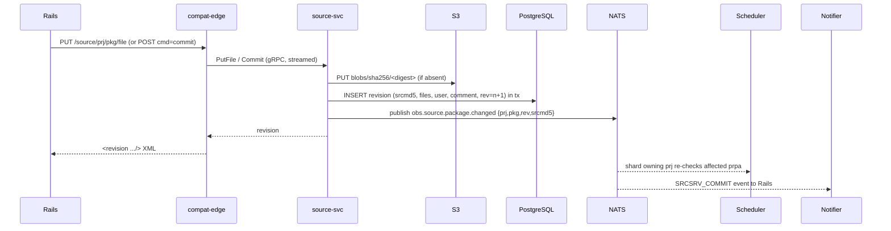

# 03 — Architecture

Depends on: `00`, `02-domain-model.md`. Read `01-legacy-system-analysis.md`
for the behaviour each service must reproduce.

## 1. Overview

The Perl backend is six long-running processes sharing one filesystem. The
new backend is a set of stateless Go services around two durable stores and
one message system:

- **PostgreSQL** holds all metadata and state machines (projects, packages,
  revisions, build state per `prpa`, jobs, workers, publish state, shard map).
- **Object storage (S3 API)** holds all content: source files, built
  binaries, logs, build pools, published repositories, indexes. Content is
  addressed by digest and immutable once written.
- **NATS JetStream** carries events between services and work queues to
  workers and publishers.

```mermaid
flowchart LR
  subgraph edge[Edge]
    RAILS[Rails API / WebUI\n(unchanged)]
    OSC[osc / CI clients]
    EDGE[compat-edge\nHTTP+XML legacy backend API]
  end
  subgraph core[Core services (gRPC)]
    SRC[source-svc]
    SCHED[scheduler\n(sharded)]
    DISP[dispatcher]
    ART[artifact-svc]
    PUB[publisher]
    SIGN[signer]
    REG[registry-svc]
    SVCRUN[service-runner]
    LOG[log-svc]
    NOTIFY[notifier]
    DOD[dod-svc]
    IDX[index-svc]
  end
  subgraph infra[Durable infrastructure]
    PG[(PostgreSQL)]
    S3[(Object storage)]
    NATS[(NATS JetStream)]
  end
  subgraph workers[Build capacity]
    WA[worker-agent\n(obs-build in KVM)]
  end
  OSC --> RAILS --> EDGE
  EDGE --> SRC & SCHED & ART & LOG & PUB & DISP
  SRC & SCHED & DISP & ART & PUB & SIGN & REG & SVCRUN & LOG & NOTIFY & DOD & IDX --> PG
  SRC & ART & PUB & LOG & REG & DOD --> S3
  SRC & SCHED & DISP & PUB & NOTIFY & SVCRUN --> NATS
  WA --> DISP & LOG
  WA --> S3
  NOTIFY --> RAILS
```

## 2. Services

| Service | Replaces | Stateful? | Scaling unit | Summary |
|---|---|---|---|---|
| compat-edge | the HTTP front of `bs_srcserver`, `bs_repserver`, `bs_service`, `bs_getbinariesproxy` | no | HPA on RPS | Serves the legacy backend HTTP/XML API to Rails and forwards to internal services. Owns XML (de)serialisation and legacy route semantics. See `06-compat-edge-api.md`. |
| source-svc | `bs_srcserver` core, `BSSrcrep`, `BSRevision`, `BSSrcServer/*` | PostgreSQL + S3 | HPA on RPS | Projects, packages, revisions, links, expansion, services trigger, remote projects, access rules, project/package events. |
| scheduler | `bs_sched`, `BSSched/*` | PostgreSQL (state) + S3 (indexes) | one replica per shard lease set | Per-`prpa` build state machine, dependency expansion, job creation, result collection, publish hand-off. |
| dispatcher | `bs_dispatch`, `bs_warden`, worker side of `bs_repserver` | PostgreSQL + NATS | HPA on queue depth | Matches jobs to workers with constraints and locality, leases jobs, detects dead workers, re-dispatches. |
| worker-agent | `bs_worker` | local cache only | KEDA on per-class queue depth | Claims jobs, fetches inputs from S3 through a node cache, runs `obs-build` in a VM, streams logs, uploads results. |
| artifact-svc | binary side of `bs_repserver`, `BSRepServer/*` | PostgreSQL + S3 | HPA | Binary pools (`:full`, `:repo`), `bininfo`, solv indexes, `buildinfo` generation, binary download, preinstall images. |
| publisher | `bs_publish`, `BSPublisher/*`, `bs_sourcepublish` | PostgreSQL + S3 | KEDA on publish queue | Generates repository metadata per repotype into the published bucket, runs hooks, syncs mirrors, pushes containers through registry-svc. |
| signer | `bs_signer`, `BSSigAuth`, client of `signd` | PostgreSQL (key metadata) | fixed small | Signs rpm/deb/repo metadata/containers/provenance; manages per-project keys; backs onto `signd`, KMS, or HSM. |
| registry-svc | `BSRegistryServer`, `BSRepServer/Registry`, `bs_regpush`, `bs_notar` | S3 | HPA | OCI distribution API over S3 for build-time pulls and published containers; pushes to external registries; signs with cosign/notary. |
| service-runner | `bs_service`, `bs_servicedispatch`, `run-service-containerized` | NATS queue | KEDA | Runs `obs-service-*` in sandboxed pods, commits results via source-svc. |
| log-svc | `:logfile` streaming in `bs_repserver`/`bs_worker` | S3 + in-memory tail | HPA | Receives live build logs from workers, serves tail/follow, archives to S3. |
| notifier | `BSNotify`, `bs_notifyforward`, `bs_redis`, `lastevents` | PostgreSQL (cursor) | 2 replicas | Converts internal events into the AMQP/RabbitMQ messages and `lastevents` long-poll stream the Rails app consumes. |
| dod-svc | `bs_dodup`, `BSSched/DoD`, `BSRepServer/DoD` | PostgreSQL + S3 | KEDA | Mirrors and indexes download-on-demand repositories. |
| index-svc | `BSDBIndex`, SQLite published/source DBs, `/search/published` | PostgreSQL | HPA | Searchable indexes of published binaries, sources, linkinfo. |
| operator | `bs_admin`, `obsstoragesetup`, `obsworker` scripts, `BSConfig.pm` | Kubernetes API | 1 | CRDs for the instance, shards, worker pools; reconciles topology; drives rebalancing. |
| importer | — | one-shot | Job | Imports `/srv/obs` into PostgreSQL and S3 (`09-migration-and-import.md`). |
| obs-admin CLI | `bs_admin`, `bs_check_consistency`, `bs_cleanup`, `bs_dbtool`, `bs_serverstatus` | — | — | Operator tooling against the gRPC APIs. |

Each service has a full specification in `services/`.

## 3. Sharding

### 3.1 Shard key

The scheduling unit is `prpa`. Shards are formed by **project**: all
repositories and architectures of a project belong to the same shard by
default. Rationale: most scheduler coupling (noarch sync, `_aggregate`,
`_multibuild`, project links, build-dependency paths that point at sibling
repositories) is intra-project, so project granularity keeps those
interactions local. The shard map (`04-storage.md` § `shard_map`) allows
explicit overrides at `prp` and `prpa` granularity for pathological projects
(for example `openSUSE:Factory` per architecture).

### 3.2 Shard ownership

- A shard is owned by exactly one scheduler replica at a time via a lease in
  PostgreSQL (`shard_lease` row with expiry, renewed every 5 s, 30 s TTL).
- All shard state is in PostgreSQL and S3; the owning replica keeps a working
  set in memory (loaded on acquisition) but nothing is lost if it dies.
- The operator assigns shards to replicas by consistent hashing over the
  shard id with a weight per replica; a rebalance moves leases gracefully
  (owner finishes the current event, persists, releases; new owner acquires).
- Cross-shard dependencies (a repository path pointing to a `prp` in another
  shard, a remote repository, a DoD repository) are read through **published
  dependency indexes** in S3 (`artifact-svc` writes `<prpa>/full.solv` and a
  `pool version` row). The dependent scheduler subscribes to
  `obs.pool.changed.<prpa>` and refreshes. This replaces reading another
  scheduler's `:full` directory.

### 3.3 Partitioning of binary pools

`artifact-svc` keeps the `:full` and `:repo` pools of a `prpa` in object
storage under a shard-scoped prefix. Shard affinity to a storage region/zone
is recorded in the shard map; the dispatcher and worker-agents use it for
locality (§ 5).

## 4. Autoscaling

| Component | Signal | Mechanism |
|---|---|---|
| compat-edge, source-svc, artifact-svc, log-svc, index-svc, registry-svc | CPU / RPS / p99 latency | HPA |
| scheduler | shard count and event backlog per shard | operator adjusts replica count and shard-to-replica weights |
| dispatcher | pending jobs, idle workers | HPA on pending-job gauge |
| worker-agent | JetStream pending messages on `obs.jobs.<arch>.<class>` | KEDA ScaledObject per worker class; scale-to-zero allowed; node pool autoscaler provides KVM-capable nodes |
| publisher, service-runner, dod-svc | queue depth | KEDA |

Workers pull work: a worker-agent claims the next job for its class from
JetStream with a lease; the dispatcher's role is to *route* jobs into the
right class queue, order them by priority and locality, and handle leases
that expire. This inverts the Perl design (dispatcher pushes to idle workers)
so that capacity can appear and disappear without registration.

## 5. Data locality

1. **Worker-side cache.** Each worker-agent keeps a content-addressed cache
   of binaries and preinstall images (as `bs_worker` does today). It reports
   a compact summary (cuckoo filter of digests, zone, class) with each job
   claim/heartbeat.
2. **Node-level cache.** A DaemonSet `cache-proxy` on every worker node
   serves S3 GETs through a shared local disk cache so co-located VMs share
   downloads; it is transparent (worker-agents fetch via it).
3. **Locality-aware routing.** The dispatcher computes for each job the set
   of input digests (from the `buildinfo`) and publishes the job into the
   class queue with a *hint* list of preferred workers (highest estimated
   cache overlap, same zone as the shard's storage). Worker-agents use
   JetStream consumer filtering to prefer hinted jobs for a bounded time
   (default 2 s) before taking any job. This yields locality without a
   central assignment step and degrades gracefully to plain pull.
4. **Zone affinity.** Shards and their pools are pinned to a storage zone;
   worker classes carry a zone label; the dispatcher prefers in-zone
   workers, cross-zone only when in-zone capacity is exhausted for longer
   than a threshold.
5. **Published data** is written immutably under digest-named paths with a
   small mutable pointer per repository, so CDNs and mirrors can cache
   aggressively (`services/publisher.md`).

## 6. Core flows

### 6.1 Source commit



### 6.2 Build

```mermaid
sequenceDiagram
  participant SC as scheduler (shard)
  participant A as artifact-svc
  participant D as dispatcher
  participant W as worker-agent
  participant L as log-svc
  participant O as S3
  SC->>A: ResolveDeps (pool versions, solv indexes)
  SC->>SC: compute buildinfo, status=scheduled
  SC->>D: SubmitJob(buildinfo, constraints, prio)
  D->>D: route to class queue with locality hints
  W->>D: ClaimJob (lease)
  W->>O: GET sources (presigned), binaries via cache-proxy
  W->>W: run obs-build in VM
  W-->>L: stream log
  W->>O: PUT result bundle (binaries, meta, provenance)
  W->>D: JobDone(result digest, status)
  D->>SC: JobFinished event
  SC->>A: Collect(result) -> update :full/:repo pools
  SC->>SC: status=succeeded/failed; trigger dependents
  SC-->>Publisher: obs.publish.requested when prpa is complete
```

### 6.3 Publish

Scheduler marks the repository complete; publisher claims the publish job,
reads the `:repo` pool, generates metadata with the repotype tooling in a
sandbox, signs through signer, writes an immutable tree to the published
bucket, flips the repository pointer, runs hooks, emits `published`.

## 7. Kubernetes topology

```mermaid
flowchart TB
  subgraph ns-obs[namespace obs]
    subgraph deployments
      EDGE[compat-edge]:::d --> SRC[source-svc]:::d
      ART[artifact-svc]:::d
      SCHED[scheduler x N]:::d
      DISP[dispatcher]:::d
      PUB[publisher]:::d
      SIGN[signer]:::d
      REG[registry-svc]:::d
      LOG[log-svc]:::d
      NOT[notifier]:::d
      IDX[index-svc]:::d
      DOD[dod-svc]:::d
      SVC[service-runner]:::d
    end
    OP[obs-operator]:::d
    NATS[(NATS JetStream\nStatefulSet)]
  end
  subgraph ns-workers[namespace obs-workers (per class)]
    WP[worker-agent DaemonSet/Deployment\nnode pool: kvm, label obs.class=x86_64-large]
    CP[cache-proxy DaemonSet]
  end
  subgraph external
    PG[(PostgreSQL HA)]
    S3[(Object storage)]
    AMQP[(RabbitMQ -> Rails)]
    SIGND[signd / KMS / HSM]
  end
  classDef d fill:#eef,stroke:#88a
```

- Worker nodes need `/dev/kvm`; expose via a KVM device plugin or run
  worker-agent pods privileged on a dedicated node pool. KubeVirt is an
  alternative where nested virtualisation is unavailable; `obs-build`'s
  `build-vm-kvm` runs inside the pod either way. Docker/podman sandboxes
  (`build-vm-podman`) are supported for formats that allow it.
- The operator CRDs: `ObsInstance`, `ObsShard`, `ObsWorkerPool`,
  `ObsRepotypeToolchain`. See `services/operator.md`.
- Ingress: compat-edge behind an internal ingress with mTLS from Rails;
  registry-svc and the published bucket behind a public ingress/CDN.

## 8. Failure model

| Failure | Behaviour |
|---|---|
| scheduler replica dies | Lease expires (≤ 30 s), another replica acquires the shard, reloads state from PostgreSQL, replays NATS events from the shard's cursor. In-flight jobs are unaffected (they are owned by the dispatcher). |
| worker dies mid-build | Lease on the job expires (heartbeat timeout); dispatcher re-queues with attempt+1; after `max_attempts` the job fails with `badhost` semantics preserved. |
| dispatcher dies | Workers keep building; claims/heartbeats fail over to another replica; JetStream retains unclaimed jobs. |
| S3 unavailable | Writes fail fast; state machines retry with backoff; no state is committed to PostgreSQL that references absent objects. |
| PostgreSQL failover | Services reconnect; all writes are transactional; idempotency keys on every mutating RPC. |
| NATS loss of a message | Not possible with JetStream persistence; consumers are durable with explicit acks; every consumer is also able to reconcile from PostgreSQL (events are hints, tables are truth). |

## 9. Principles for implementers

1. **Tables are truth, events are hints.** Every consumer must produce the
   correct result if it misses an event and later re-reads the tables.
2. **Immutable content, mutable pointers.** Never overwrite an object; write a
   new digest-named object and update a row.
3. **Idempotent RPCs.** Every mutating RPC carries an idempotency key; repeats
   return the original result.
4. **Shard-local by default.** A scheduler touches only its shard's tables
   directly; cross-shard information is read via published indexes.
5. **Parity over elegance.** Where the Perl behaviour is surprising but
   visible to users, keep it and document it in `01`.

## 10. Open questions

- Whether `compat-edge` and `source-svc` should be one binary in phase 1 to
  reduce hops for the many thin `/source` routes. The spec keeps them
  separate; collapsing is an implementation choice that must not change the
  proto contract.
- Whether to keep a legacy worker protocol adapter so unmodified `bs_worker`
  hosts can join during migration. Default: no; the Go worker-agent ships
  first.
