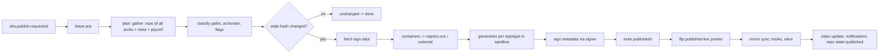

# Service: publisher

Replaces: `bs_publish`, `BSPublisher/{Container,Containerinfo,Helm,Diffnotify,
Blobstore,Util}.pm`, `bs_regpush`, `bs_notar`, `bs_mkapkrepo`, `bs_mkarchrepo`,
`bs_sourcepublish`, publisher side of `BSUrlmapper.pm`, the published-DB
feeder.

Reference analysis: `01-legacy-system-analysis.md` § P.
Contracts: `proto/publish.proto`, `proto/artifact.proto`, `proto/sign.proto`.
Storage: `04-storage.md` § 1.1 (`published/`, `published-live/`), § 2.3
(`publish_job`, `published_*`).

## 1. Responsibilities

1. Consume `obs.publish.requested` per prp; serialise per prp with a lease;
   coalesce duplicates; retry with the legacy back-off and error-class rules.
2. Build the **publish plan** from the `:repo` snapshots of all architectures
   of the prp (`repo_pool`, `repo_info`), project metadata (`GetProjPack`
   with `nopackages`) and prjconf (`repotype`, `patterntype`, `publishflags`,
   `signflavor`).
3. Classify every entry into a published path (P § 1.3.6 table, ~40
   patterns), apply `archorder`, `nocontentchange`, `splitdebug`,
   `packagesubdir`, `slepool`/`sleimage` renames, container decisions.
4. Compute the state hash; exit early as `unchanged`.
5. Generate repository metadata per repotype and patterntype in a sandboxed
   **generator** container with the exact tool invocations of P § 1.4-1.5;
   sign through `signer`.
6. Write an **immutable published version** under `published/<prp>/<version>/`
   with the legacy on-disk layout, then flip `published-live/<prp>`.
7. Push containers and charts to registries (internal `registry-svc` or
   external) with cosign/Rekor/notary semantics; delete obsolete tags.
8. Run mirror sync (rsync exporter for stage servers, trigger files), hooks
   (`publishedhook`/`unpublishedhook` as webhook subscribers or script
   jobs), Rekor uploads.
9. Update the published index (`index-svc`), emit notifications
   (`REPO_PUBLISH_STATE`, `REPO_PUBLISHED`, `CONTAINER_PUBLISHED`,
   `PACKTRACK`, `sourcepublish`, diffnotify JSON).
10. Delete/unpublish flows and `createempty`.
11. Source publishing export.

## 2. Pipeline

Steps 2-5 read binaries through a **local object cache** inside the
generator sandbox (binaries are needed on disk by `createrepo_c`,
`dpkg-scanpackages`, `Build::query`-equivalents). The cache is keyed by
sha256 and shared across publishes on the same node.

## 3. Published layout and versioning

- Path inside a version is exactly the legacy layout:
  `<prj with ':' -> ':/'>/<repo>/{<arch>/, repodata/, iso/, repo/, boxes/,
  Packages*, Sources*, Release*, InRelease, media.1/, descr/, content,
  <project>.repo, *.ymp, index.yaml, SHA256SUMS*, …}`.
- Binaries inside a version are **references** (object keys) to
  `bins/sha256/…`; metadata files are new objects. The published gateway
  (`published-gw`, part of compat-edge deployment) serves
  `GET /published/<prp>/<path>` by resolving the live pointer and
  redirecting or proxying; `staticlinks` symlinks become redirect entries in
  the version's manifest; `directory.yast` and index listings are generated
  objects.
- Version id = `publishid` (monotonic per prp, legacy semantics: old+1 or
  starttime).
- Retention: last 2 versions + pinned; GC removes older versions and
  unreferenced metadata objects.
- Mirrors: `rsync` exporter materialises a version into a staging directory
  and runs the legacy two-pass rsync + trigger file; alternatively a mirror
  pulls the version manifest and syncs by digest.

## 4. Generators

| Repotype | Tool in sandbox image | Signing |
|---|---|---|
| `rpm-md` (+ opts `legacy`, `sha512`, `zchunk`, `compression-zstd`, `filelists-ext`, `deltainfo`, `prestodelta`, `cmssign`, `rsyncable`, `sbom-*`) | `createrepo_c`, `modifyrepo_c`, `writemodulemd`, `generate_sbom`, `repoview`, `rezip_repo_rsyncable`; exact flags per P § 1.4 | `repomd.xml.asc` (pgp v4 detached), `.key`, optional `.p7s` CMS |
| `suse` (susetags) | `create_package_descr` | none |
| `hdlist2` | `genhdlist2` | none |
| `debian` (flat) | Go-native `Packages`/`Sources`/`Release` with the exact field set; `gzip -9n` | `Release.gpg`, `InRelease`, `Release.key` |
| `arch` | Go-native db/files tarballs | `.sig` detached binary + `.key` |
| `apk` | Go-native APKINDEX | RSA raw signature embedded |
| `vagrant`, `staticlinks`, `zyppservice`, `helm`, `checksumsfile`, `virtbuilder` | Go-native | as P § 1.4 |
| patterns `ymp`, `rpm-md`, `comps`; `appdata`; `deltainfo`/`prestodelta`; modulemd; updateinfo | Go-native XML generation; `modifyrepo_c` for insertion | re-sign `repomd.xml` after insertion |

`publishprogram` and `createrepo_rpmmd_hook` site hooks are supported as a
"custom generator" step that runs an operator-provided image with the same
arguments.

## 5. Containers

Implements `upload_all_containers` (P § 3): tag mapping
(`default_container_mapper` + site mapper), conflict resolution by
version/release, platform strings, per-registry `query_repostate` with
`If-None-Match` revalidation, `compare_to_repostate` with locally computed
manifest digests, push with `go-containerregistry` (blobs, layers with
normalisation, manifests, manifest lists/OCI index), cosign `.sig`/`.att`
tags with the OBS cookie annotation or sigstore bundle referrers, Rekor
uploads, obsolete-tag deletion with safeguard modes, notary v1 (kept as an
optional sidecar), `manifestinfos`, ArtifactHub tag, `<name>.registry.txt`
replacement in the published tree, `CONTAINER_PUBLISHED` notifications.
Credentials come from Kubernetes secrets referenced by registry name.

## 6. Error handling

Legacy prefixes map to classes: `NORETRY`/`CRITICAL_NORETRY` → job state
`failed` with `details` visible in `/published?view=status` and the publish
request parked until a new request arrives; `CRITICAL` → alert + retry;
`RETRY_AFTER<n>` → backoff n; otherwise exponential 1..32 min. `delayed`
(archsync) re-queues and sends `recheck` to lagging schedulers.
`publish_penalty_multiplier` is honoured.

## 7. Scaling

KEDA on queue depth; per-prp lease prevents concurrent publishes of one prp;
flavour limits (`publish_maxchild_flavor`) become per-flavour consumer
groups. Generators are CPU/disk heavy and run as Kubernetes Jobs or as
sidecar pools sized by the operator.

## 8. Compatibility obligations

Everything in P § 6.3: arch precedence, `publishid`, tag mapping,
`.registry.txt`, flags, signature artefact names, `prp_ext` keys,
`/published` URL scheme, retry/stuck semantics, `<project>.repo` contents,
`repotag` entries.

## 9. Tasks

`work-breakdown/epics.md` E8.
