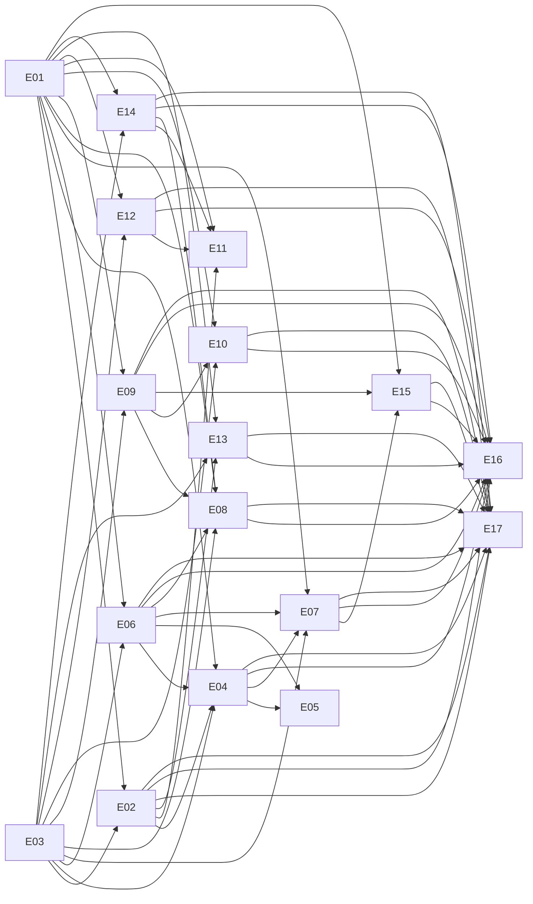

# Epics, Milestones, Dependencies

## Milestones

| Milestone | Goal | Exit criteria |
|---|---|---|
| **M0 Foundations** | shared libraries, contracts, infra, corpus | `pkg/bsxml` renders every corpus document byte-identically; all ids reproduce; protos frozen for M1; `kind` dev stack boots; corpus repo populated |
| **M1 Sources** | source-svc + compat-edge `/source` routes; notifier; service-runner; index (package search) | `osc` checkout/commit/branch/diff/service flows pass e2e against Rails; parity for all `/source` routes |
| **M2 Builds** | scheduler, artifact-svc, dispatcher, worker-agent, log-svc, dod-svc, signer; compat-edge `/build` routes | corpus projects build end to end on `kind` with a KVM pool; scheduler decision diff = 0 on corpus; proto freeze |
| **M3 Publishing** | publisher, registry-svc, index (published), sign-worker | published trees and container pushes match the Perl output on the corpus; `/published`, `/search/published`, `/registry` parity |
| **M4 Operations** | operator, Helm, observability, obs-admin, importer, migration rehearsal | import of a snapshot instance; M0-M3 rehearsal cutover on staging; runbooks; perf targets met |
| **M5 Hardening** | chaos, security review, interconnect against a Perl peer, docs | release candidate |

## Epics

| Epic | Name | Milestone | Spec | Size |
|---|---|---|---|---|
| E01 | Foundations: bsxml, bsverify, ids, legacy errors, corpus | M0 | `02`, `06`, `10`, F § D | XL (split) |
| E02 | source-svc | M1 | `services/source-svc.md`, S | XL (split) |
| E03 | Storage, events, infra libraries (store, objstore, events, migrations, dev stack) | M0 | `04`, `05` | L |
| E04 | Scheduler core (shard loop, lookat, check pipeline, default handler) | M2 | `services/scheduler.md`, B | XL (split) |
| E05 | Scheduler handlers (kiwi, docker, product, aggregate, channel, patchinfo, delta, import, upload, reproducible, preinstallimage, image) | M2 | B § 4.4 | XL (split) |
| E06 | artifact-svc + dod-svc (pools, integration, buildinfo, binary access, DoD) | M2 | `services/artifact-svc.md`, `dod-svc.md`, B | XL (split) |
| E07 | dispatcher + worker protocol + log-svc | M2 | `services/dispatcher.md`, `log-svc.md`, B build-path § 3-5 | L |
| E08 | publisher (generators, containers push, mirrors, hooks) | M3 | `services/publisher.md`, P | XL (split) |
| E09 | signer (sign-svc, sign-worker, pkg/signing) | M2/M3 | `services/signer.md`, P § 2 | L |
| E10 | registry-svc | M3 | `services/registry-svc.md`, P § 3 | L |
| E11 | compat-edge (all routes, long-poll, streams, published-gw) | M1-M3 | `06`, `06a`, `services/compat-edge.md` | XL (split) |
| E12 | notifier | M1 | `services/notifier.md`, F § A.6 | M |
| E13 | service-runner (services, obs-scm, tools sandbox) | M1 | `services/service-runner.md`, F § C | L |
| E14 | index-svc | M1/M3 | `services/index-svc.md`, P § 4 | M |
| E15 | worker-agent + cache-proxy | M2 | `services/worker-agent.md`, B build-path § 4, § 7 | XL (split) |
| E16 | operator, Helm, obs-admin, observability | M4 | `services/operator.md`, `08` | L |
| E17 | importer, migration, parity harness, e2e | M4 | `services/importer.md`, `09`, `10` | L |

## Dependency graph

Critical path: E01 → E03 → E02 → E06 → E04 → E07 → E15 → E17.

## Parallelism guidance

- M0: E01 and E03 in parallel, up to 8 agents (E01 splits by schema groups
  and id algorithms; E03 by store/objstore/events/dev-stack).
- M1: E02 (6-8 agents by RPC group), E11 `/source` routes (2-3), E12, E13,
  E14 (1-2 each).
- M2: E04 (4-6), E05 (one agent per handler family), E06 (4-6), E07 (2-3),
  E09 (2), E15 (3-4), E11 `/build` routes (2-3).
- M3: E08 (one agent per generator family + containers + mirrors), E10 (2),
  E11 `/published` + `/registry` (2), E14 published (1).
- M4: E16 (3-4), E17 (3-4).

Every task lists its own parity subset; a milestone is reached when all its
epics' acceptance criteria pass together in the e2e suite.
